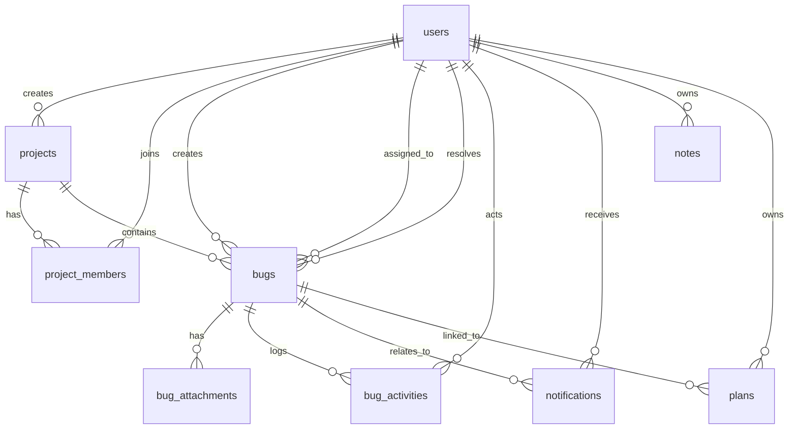

# SnapBug 数据库表结构设计

> **数据库**：PostgreSQL  
> **ORM**：Prisma  
> **关联文档**：[需求背景](./background.md) · [技术选型](./tech-stack.md) · [产品需求文档](./prd.md)

---

## 1. ER 关系总览

系统共有 **9 张核心业务表**，围绕 `Project → Bug` 极简层级以及个人空间（笔记 / 计划）构建，无冗余套娃层级。



---

## 2. 核心设计要点

1. **隐式项目授权（`project_members`）**：
   - 创建项目时自动插入 `(project_id, creator_id, CREATOR)`；
   - 提 Bug 或转派 Bug 时，在同一数据库事务中使用 `INSERT ... ON CONFLICT DO NOTHING`（Prisma `upsert`）将目标 `assignee_id` 自动写入 `project_members`（`joined_via = ASSIGNED`），实现零配置权限流转。
2. **Bug 编号并发安全生成（`bug_code_seq`）**：
   - 保留 `bugs.code`（`UNIQUE, NOT NULL`）以支持直白的大小写不敏感模糊搜索（如 `BUG-104` / `104`）；
   - 初始 migration 内置 PostgreSQL 独立序列 `CREATE SEQUENCE bug_code_seq START WITH 101;`，新建 Bug 时在事务内执行 `SELECT nextval('bug_code_seq')` 拼装 `BUG-<seq>`，零并发撞号、无二次 `UPDATE`。
3. **当前快照与历史事件分离（`bugs` + `bug_activities`）**：
   - `bugs.resolver_id`、`resolved_at`、`closed_at` 作为当前快照字段：`resolved_at` 仅在首次进入 `VERIFY`/`CLOSED` 时写入（便于计算首次响应时长）；切入 `CLOSED` 时写入 `closed_at`，**任何从 `CLOSED` 切往非 `CLOSED`（`OPEN`/`PROGRESS`/`VERIFY`/`IGNORED`）统一清空 `closed_at`**；
   - 历史**月报/周报的 Bug 贡献汇总**与工作台**近 7 日每日关闭趋势**统一以 `bug_activities` 中 `type = STATUS_CHANGED` 的状态事件为准（按 `bug_id` 去重），彻底避免重开后覆盖 `resolver_id` 或清空 `closed_at` 导致历史数据漏单或漂移；
   - `bug_activities` 利用 PostgreSQL `JSONB` 字段 `meta` 固定契约 `{ "fromStatus": "...", "toStatus": "...", "autoAssignedTo"?: number }`，并建立 `(actor_id, type, created_at)` 与 `(type, created_at)` 复合索引支撑聚合查询。
4. **云对象存储无落盘与防越权命名空间（`bug_attachments`）**：
   - 数据库仅存云存储 `object_key` 与文件元数据，不存储二进制内容；`bug_attachments.object_key` 加 `UNIQUE` 约束，防止同一上传对象被重复绑定到其他 Bug；
   - 个人笔记图片采用后端受控路径命名空间 `notes/u{userId}/{yyyy}/{mm}/{uuid}.{ext}`，通过前缀中的 `userId` 校验归属，**首版无需额外新建关系表**。

---

## 3. 表结构明细

### 3.1 `users`（用户表）

| 字段名            | 类型           | 约束                       | 说明                                   |
| ----------------- | -------------- | -------------------------- | -------------------------------------- |
| `id`              | `SERIAL`       | PK                         | 用户 ID                                |
| `account`         | `VARCHAR(100)` | UNIQUE, NOT NULL           | 登录账号或邮箱（默认超管为 `admin`）   |
| `password_hash`   | `VARCHAR(255)` | NOT NULL                   | bcrypt 加密密码                        |
| `name`            | `VARCHAR(50)`  | NOT NULL                   | 展示姓名                               |
| `job_title`       | `VARCHAR(50)`  | NULL                       | 岗位标签（如前端开发/测试工程师）      |
| `avatar_color`    | `VARCHAR(20)`  | NOT NULL                   | 默认文字头像色值（如 `#1b74ff`）       |
| `avatar_key`      | `VARCHAR(255)` | NULL                       | 自定义头像 OSS Object Key              |
| `role`            | `UserRole`     | NOT NULL, DEFAULT `MEMBER` | `ADMIN`（超管） / `MEMBER`（普通成员） |
| `status`          | `UserStatus`   | NOT NULL, DEFAULT `ACTIVE` | `ACTIVE`（启用） / `DISABLED`（禁用）  |
| `last_project_id` | `INT`          | NULL                       | 记忆上次提 Bug 所选项目 ID             |
| `created_at`      | `TIMESTAMPTZ`  | NOT NULL                   | 创建时间                               |
| `updated_at`      | `TIMESTAMPTZ`  | NOT NULL                   | 更新时间                               |

---

### 3.2 `projects`（项目表）

| 字段名        | 类型           | 约束                      | 说明             |
| ------------- | -------------- | ------------------------- | ---------------- |
| `id`          | `SERIAL`       | PK                        | 项目 ID          |
| `name`        | `VARCHAR(100)` | NOT NULL                  | 项目名称         |
| `description` | `VARCHAR(500)` | NULL                      | 项目简介         |
| `creator_id`  | `INT`          | FK → `users.id`           | 创建人           |
| `archived`    | `BOOLEAN`      | NOT NULL, DEFAULT `false` | 是否归档（预留） |
| `created_at`  | `TIMESTAMPTZ`  | NOT NULL                  | 创建时间         |
| `updated_at`  | `TIMESTAMPTZ`  | NOT NULL                  | 更新时间         |

---

### 3.3 `project_members`（项目成员表）

| 字段名       | 类型              | 约束                         | 说明                                        |
| ------------ | ----------------- | ---------------------------- | ------------------------------------------- |
| `id`         | `SERIAL`          | PK                           | 主键                                        |
| `project_id` | `INT`             | FK → `projects.id` (CASCADE) | 项目 ID                                     |
| `user_id`    | `INT`             | FK → `users.id` (CASCADE)    | 成员 ID                                     |
| `joined_via` | `ProjectJoinType` | NOT NULL                     | 加入来源：`CREATOR` / `ASSIGNED` / `MANUAL` |
| `created_at` | `TIMESTAMPTZ`     | NOT NULL                     | 加入时间                                    |

- **唯一索引**：`UNIQUE(project_id, user_id)`
- **查询索引**：`INDEX(user_id)`

---

### 3.4 `bugs`（缺陷主表）

| 字段名             | 类型           | 约束                            | 说明                                                                  |
| ------------------ | -------------- | ------------------------------- | --------------------------------------------------------------------- |
| `id`               | `SERIAL`       | PK                              | 自增主键                                                              |
| `code`             | `VARCHAR(30)`  | UNIQUE, NOT NULL                | 展示编号（如 `BUG-101`，基于序列生成）                                |
| `project_id`       | `INT`          | FK → `projects.id`              | 所属项目                                                              |
| `title`            | `VARCHAR(200)` | NOT NULL                        | 问题标题                                                              |
| `description`      | `TEXT`         | NOT NULL                        | 问题描述（纯文本）                                                    |
| `status`           | `BugStatus`    | NOT NULL, DEFAULT `OPEN`        | `OPEN` / `PROGRESS` / `VERIFY` / `CLOSED` / `IGNORED`                 |
| `priority`         | `BugPriority`  | NOT NULL, DEFAULT `P1`          | `P0` / `P1` / `P2`                                                    |
| `creator_id`       | `INT`          | FK → `users.id`                 | 提单人                                                                |
| `assignee_id`      | `INT`          | FK → `users.id`                 | 当前指派人                                                            |
| `resolver_id`      | `INT`          | FK → `users.id`, NULL           | 解决人（将状态推进至 `VERIFY`/`CLOSED` 的操作人）                     |
| `related_bug_id`   | `INT`          | FK → `bugs.id` (SET NULL), NULL | 预留：关联历史 Bug（如复发溯源指向的旧单，后续相似缺陷回溯能力使用）  |
| `verify_checklist` | `JSONB`        | NULL                            | 预留：待验证验收清单（`[{ id, text, status, round, failedBefore }]`） |
| `ai_optimized`     | `BOOLEAN`      | NOT NULL, DEFAULT `false`       | 是否经 AI 一键优化                                                    |
| `resolved_at`      | `TIMESTAMPTZ`  | NULL                            | 首次解决（待验证/关闭）时间                                           |
| `closed_at`        | `TIMESTAMPTZ`  | NULL                            | 关闭时间                                                              |
| `created_at`       | `TIMESTAMPTZ`  | NOT NULL                        | 创建时间                                                              |
| `updated_at`       | `TIMESTAMPTZ`  | NOT NULL                        | 更新时间                                                              |

- **核心索引**：
  - `INDEX(project_id, status)`
  - `INDEX(assignee_id, status)`
  - `INDEX(creator_id, status)`
  - `INDEX(resolver_id, resolved_at)`
  - `INDEX(related_bug_id)`
  - `INDEX(created_at)`、`INDEX(closed_at)`

---

### 3.5 `bug_attachments`（Bug 媒体附件表）

| 字段名        | 类型             | 约束                     | 说明                                      |
| ------------- | ---------------- | ------------------------ | ----------------------------------------- |
| `id`          | `SERIAL`         | PK                       | 主键                                      |
| `bug_id`      | `INT`            | FK → `bugs.id` (CASCADE) | 所属 Bug                                  |
| `uploader_id` | `INT`            | FK → `users.id`          | 上传人                                    |
| `type`        | `AttachmentType` | NOT NULL                 | `IMAGE` / `VIDEO`                         |
| `object_key`  | `VARCHAR(500)`   | UNIQUE, NOT NULL         | 云对象存储 Key（阿里云 OSS / 腾讯云 COS） |
| `file_name`   | `VARCHAR(255)`   | NOT NULL                 | 原始文件名                                |
| `mime_type`   | `VARCHAR(100)`   | NOT NULL                 | MIME 类型（如 `image/png`、`video/mp4`）  |
| `file_size`   | `INT`            | NOT NULL                 | 文件大小（字节）                          |
| `created_at`  | `TIMESTAMPTZ`    | NOT NULL                 | 创建时间                                  |

- **索引**：`INDEX(bug_id)`

---

### 3.6 `bug_activities`（Bug 处理记录与活动时间线）

| 字段名       | 类型           | 约束                     | 说明                                                                                 |
| ------------ | -------------- | ------------------------ | ------------------------------------------------------------------------------------ |
| `id`         | `SERIAL`       | PK                       | 主键                                                                                 |
| `bug_id`     | `INT`          | FK → `bugs.id` (CASCADE) | 所属 Bug                                                                             |
| `actor_id`   | `INT`          | FK → `users.id`          | 操作人 / 评论人                                                                      |
| `type`       | `ActivityType` | NOT NULL                 | `CREATED` / `COMMENT` / `STATUS_CHANGED` / `ASSIGNEE_CHANGED` / `PRIORITY_CHANGED`   |
| `content`    | `TEXT`         | NULL                     | 评论正文或可读日志描述                                                               |
| `meta`       | `JSONB`        | NULL                     | 变更结构化元数据（如 `{ "from": "PROGRESS", "to": "VERIFY", "autoAssignedTo": 3 }`） |
| `created_at` | `TIMESTAMPTZ`  | NOT NULL                 | 创建时间                                                                             |

- **索引**：`INDEX(bug_id, created_at)`、`INDEX(actor_id, type, created_at)`、`INDEX(type, created_at)`

---

### 3.7 `notifications`（站内消息通知表）

| 字段名         | 类型               | 约束                      | 说明                                                                     |
| -------------- | ------------------ | ------------------------- | ------------------------------------------------------------------------ |
| `id`           | `SERIAL`           | PK                        | 主键                                                                     |
| `recipient_id` | `INT`              | FK → `users.id` (CASCADE) | 接收人                                                                   |
| `actor_id`     | `INT`              | FK → `users.id`           | 触发人                                                                   |
| `bug_id`       | `INT`              | FK → `bugs.id` (CASCADE)  | 关联 Bug（点击直达详情抽屉）                                             |
| `type`         | `NotificationType` | NOT NULL                  | `BUG_ASSIGNED` / `BUG_REASSIGNED` / `BUG_VERIFY_READY` / `BUG_COMMENTED` |
| `content`      | `VARCHAR(500)`     | NOT NULL                  | 通知展示文案                                                             |
| `is_read`      | `BOOLEAN`          | NOT NULL, DEFAULT `false` | 是否已读                                                                 |
| `read_at`      | `TIMESTAMPTZ`      | NULL                      | 已读时间                                                                 |
| `created_at`   | `TIMESTAMPTZ`      | NOT NULL                  | 创建时间                                                                 |

- **索引**：`INDEX(recipient_id, is_read, created_at DESC)`

---

### 3.8 `notes`（个人笔记表 · 纯私有）

| 字段名       | 类型           | 约束                      | 说明                                      |
| ------------ | -------------- | ------------------------- | ----------------------------------------- |
| `id`         | `SERIAL`       | PK                        | 主键                                      |
| `user_id`    | `INT`          | FK → `users.id` (CASCADE) | 所属用户（仅本人可见）                    |
| `title`      | `VARCHAR(200)` | NOT NULL, DEFAULT `""`    | 笔记标题                                  |
| `content`    | `TEXT`         | NOT NULL, DEFAULT `""`    | Markdown 正文（内嵌图片走云存储 Key/URL） |
| `created_at` | `TIMESTAMPTZ`  | NOT NULL                  | 创建时间                                  |
| `updated_at` | `TIMESTAMPTZ`  | NOT NULL                  | 最后更新时间（列表按此倒序）              |

- **索引**：`INDEX(user_id, updated_at DESC)`

---

### 3.9 `plans`（个人工作计划表 · 按日期管理）

| 字段名       | 类型           | 约束                            | 说明                              |
| ------------ | -------------- | ------------------------------- | --------------------------------- |
| `id`         | `SERIAL`       | PK                              | 主键                              |
| `user_id`    | `INT`          | FK → `users.id` (CASCADE)       | 所属用户（仅本人可见）            |
| `plan_date`  | `DATE`         | NOT NULL                        | 所属自然日（`YYYY-MM-DD`）        |
| `plan_time`  | `VARCHAR(10)`  | NULL                            | 可选时间点（如 `09:30`、`14:00`） |
| `content`    | `VARCHAR(500)` | NOT NULL                        | 计划内容                          |
| `remark`     | `VARCHAR(500)` | NULL                            | 补充说明                          |
| `is_done`    | `BOOLEAN`      | NOT NULL, DEFAULT `false`       | 是否完成                          |
| `done_at`    | `TIMESTAMPTZ`  | NULL                            | 完成时间                          |
| `bug_id`     | `INT`          | FK → `bugs.id` (SET NULL), NULL | 关联 Bug（「加入今日计划」写入）  |
| `created_at` | `TIMESTAMPTZ`  | NOT NULL                        | 创建时间                          |
| `updated_at` | `TIMESTAMPTZ`  | NOT NULL                        | 更新时间                          |

- **索引**：`INDEX(user_id, plan_date)`、`INDEX(user_id, is_done, plan_date)`

---

## 4. Prisma Schema 参考实现

```prisma
generator client {
  provider            = "prisma-client"
  output              = "../generated/prisma"
  moduleFormat        = "cjs"
  importFileExtension = "js"
}

datasource db {
  provider = "postgresql"
}

enum UserRole {
  ADMIN
  MEMBER
}

enum UserStatus {
  ACTIVE
  DISABLED
}

enum ProjectJoinType {
  CREATOR
  ASSIGNED
  MANUAL
}

enum BugStatus {
  OPEN
  PROGRESS
  VERIFY
  CLOSED
  IGNORED
}

enum BugPriority {
  P0
  P1
  P2
}

enum AttachmentType {
  IMAGE
  VIDEO
}

enum ActivityType {
  CREATED
  COMMENT
  STATUS_CHANGED
  ASSIGNEE_CHANGED
  PRIORITY_CHANGED
}

enum NotificationType {
  BUG_ASSIGNED
  BUG_REASSIGNED
  BUG_VERIFY_READY
  BUG_COMMENTED
}

model User {
  id            Int        @id @default(autoincrement())
  account       String     @unique @db.VarChar(100)
  passwordHash  String     @map("password_hash") @db.VarChar(255)
  name          String     @db.VarChar(50)
  jobTitle      String?    @map("job_title") @db.VarChar(50)
  avatarColor   String     @default("#1b74ff") @map("avatar_color") @db.VarChar(20)
  avatarKey     String?    @map("avatar_key") @db.VarChar(255)
  role          UserRole   @default(MEMBER)
  status        UserStatus @default(ACTIVE)
  lastProjectId Int?       @map("last_project_id")
  createdAt     DateTime   @default(now()) @map("created_at") @db.Timestamptz
  updatedAt     DateTime   @updatedAt @map("updated_at") @db.Timestamptz

  createdProjects   Project[]       @relation("ProjectCreator")
  projectMembers    ProjectMember[]
  createdBugs       Bug[]           @relation("BugCreator")
  assignedBugs      Bug[]           @relation("BugAssignee")
  resolvedBugs      Bug[]           @relation("BugResolver")
  bugAttachments    BugAttachment[]
  bugActivities     BugActivity[]
  receivedNotifs    Notification[]  @relation("NotificationRecipient")
  triggeredNotifs   Notification[]  @relation("NotificationActor")
  notes             Note[]
  plans             Plan[]

  @@index([role, status])
  @@map("users")
}

model Project {
  id          Int      @id @default(autoincrement())
  name        String   @db.VarChar(100)
  description String?  @db.VarChar(500)
  creatorId   Int      @map("creator_id")
  archived    Boolean  @default(false)
  createdAt   DateTime @default(now()) @map("created_at") @db.Timestamptz
  updatedAt   DateTime @updatedAt @map("updated_at") @db.Timestamptz

  creator User            @relation("ProjectCreator", fields: [creatorId], references: [id])
  members ProjectMember[]
  bugs    Bug[]

  @@map("projects")
}

model ProjectMember {
  id        Int             @id @default(autoincrement())
  projectId Int             @map("project_id")
  userId    Int             @map("user_id")
  joinedVia ProjectJoinType @default(ASSIGNED) @map("joined_via")
  createdAt DateTime        @default(now()) @map("created_at") @db.Timestamptz

  project Project @relation(fields: [projectId], references: [id], onDelete: Cascade)
  user    User    @relation(fields: [userId], references: [id], onDelete: Cascade)

  @@unique([projectId, userId])
  @@index([userId])
  @@map("project_members")
}

model Bug {
  id          Int         @id @default(autoincrement())
  code        String      @unique @db.VarChar(30)
  projectId   Int         @map("project_id")
  title       String      @db.VarChar(200)
  description String      @db.Text
  status      BugStatus   @default(OPEN)
  priority    BugPriority @default(P1)
  creatorId   Int         @map("creator_id")
  assigneeId  Int         @map("assignee_id")
  resolverId      Int?        @map("resolver_id")
  relatedBugId    Int?        @map("related_bug_id")
  verifyChecklist Json?       @map("verify_checklist")
  aiOptimized     Boolean     @default(false) @map("ai_optimized")
  resolvedAt      DateTime?   @map("resolved_at") @db.Timestamptz
  closedAt        DateTime?   @map("closed_at") @db.Timestamptz
  createdAt       DateTime    @default(now()) @map("created_at") @db.Timestamptz
  updatedAt       DateTime    @updatedAt @map("updated_at") @db.Timestamptz

  project       Project         @relation(fields: [projectId], references: [id])
  creator       User            @relation("BugCreator", fields: [creatorId], references: [id])
  assignee      User            @relation("BugAssignee", fields: [assigneeId], references: [id])
  resolver      User?           @relation("BugResolver", fields: [resolverId], references: [id])
  relatedBug    Bug?            @relation("BugRelation", fields: [relatedBugId], references: [id], onDelete: SetNull)
  relatedBugs   Bug[]           @relation("BugRelation")
  attachments   BugAttachment[]
  activities    BugActivity[]
  notifications Notification[]
  plans         Plan[]

  @@index([projectId, status])
  @@index([assigneeId, status])
  @@index([creatorId, status])
  @@index([resolverId, resolvedAt])
  @@index([relatedBugId])
  @@index([createdAt])
  @@index([closedAt])
  @@map("bugs")
}

model BugAttachment {
  id         Int            @id @default(autoincrement())
  bugId      Int            @map("bug_id")
  uploaderId Int            @map("uploader_id")
  type       AttachmentType
  objectKey  String         @unique @map("object_key") @db.VarChar(500)
  fileName   String         @map("file_name") @db.VarChar(255)
  mimeType   String         @map("mime_type") @db.VarChar(100)
  fileSize   Int            @map("file_size")
  createdAt  DateTime       @default(now()) @map("created_at") @db.Timestamptz

  bug      Bug  @relation(fields: [bugId], references: [id], onDelete: Cascade)
  uploader User @relation(fields: [uploaderId], references: [id])

  @@index([bugId])
  @@map("bug_attachments")
}

model BugActivity {
  id        Int          @id @default(autoincrement())
  bugId     Int          @map("bug_id")
  actorId   Int          @map("actor_id")
  type      ActivityType
  content   String?      @db.Text
  meta      Json?
  createdAt DateTime     @default(now()) @map("created_at") @db.Timestamptz

  bug   Bug  @relation(fields: [bugId], references: [id], onDelete: Cascade)
  actor User @relation(fields: [actorId], references: [id])

  @@index([bugId, createdAt])
  @@index([actorId, type, createdAt])
  @@index([type, createdAt])
  @@map("bug_activities")
}

model Notification {
  id          Int              @id @default(autoincrement())
  recipientId Int              @map("recipient_id")
  actorId     Int              @map("actor_id")
  bugId       Int              @map("bug_id")
  type        NotificationType
  content     String           @db.VarChar(500)
  isRead      Boolean          @default(false) @map("is_read")
  readAt      DateTime?        @map("read_at") @db.Timestamptz
  createdAt   DateTime         @default(now()) @map("created_at") @db.Timestamptz

  recipient User @relation("NotificationRecipient", fields: [recipientId], references: [id], onDelete: Cascade)
  actor     User @relation("NotificationActor", fields: [actorId], references: [id])
  bug       Bug  @relation(fields: [bugId], references: [id], onDelete: Cascade)

  @@index([recipientId, isRead, createdAt(sort: Desc)])
  @@map("notifications")
}

model Note {
  id        Int      @id @default(autoincrement())
  userId    Int      @map("user_id")
  title     String   @default("") @db.VarChar(200)
  content   String   @default("") @db.Text
  createdAt DateTime @default(now()) @map("created_at") @db.Timestamptz
  updatedAt DateTime @updatedAt @map("updated_at") @db.Timestamptz

  user User @relation(fields: [userId], references: [id], onDelete: Cascade)

  @@index([userId, updatedAt(sort: Desc)])
  @@map("notes")
}

model Plan {
  id        Int       @id @default(autoincrement())
  userId    Int       @map("user_id")
  planDate  DateTime  @map("plan_date") @db.Date
  planTime  String?   @map("plan_time") @db.VarChar(10)
  content   String    @db.VarChar(500)
  remark    String?   @db.VarChar(500)
  isDone    Boolean   @default(false) @map("is_done")
  doneAt    DateTime? @map("done_at") @db.Timestamptz
  bugId     Int?      @map("bug_id")
  createdAt DateTime  @default(now()) @map("created_at") @db.Timestamptz
  updatedAt DateTime  @updatedAt @map("updated_at") @db.Timestamptz

  user User @relation(fields: [userId], references: [id], onDelete: Cascade)
  bug  Bug? @relation(fields: [bugId], references: [id], onDelete: SetNull)

  @@index([userId, planDate])
  @@index([userId, isDone, planDate])
  @@map("plans")
}
```

---

## 5. 初始化种子数据（Seed）约定

首次部署执行 Prisma Seed 时自动幂等初始化：

- 若 `users` 表中不存在 `role = ADMIN` 记录，则创建默认超管账号：
  - `account`: `process.env.INIT_ADMIN_ACCOUNT || 'admin'`
  - `password`: `bcrypt.hash(process.env.INIT_ADMIN_PASSWORD || 'admin123')`
  - `name`: `超级管理员`
  - `role`: `ADMIN`
